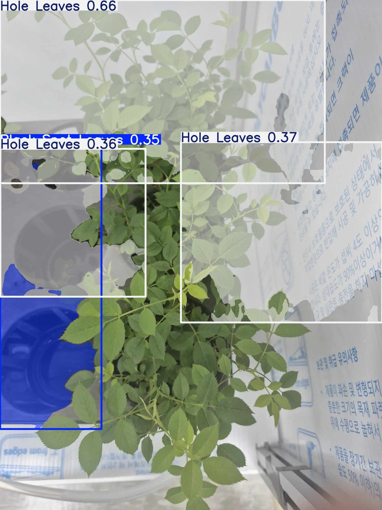

# v1 리포트: 자동 생성 배경 합성 데이터로 첫 학습

> 그림과 비교 표를 포함한 리포트: [REPORT.html](REPORT.html) (전체 비교: [REPORTS.html](../REPORTS.html))

| 항목 | 내용 |
|---|---|
| 유형 | 데이터 + 모델 |
| 작업일 | 2026-10-12 |
| 대표 모델 | `runs/yolo26s-seg/weights/best.pt` (YOLO26s-seg, 4클래스) |
| 상태 | 기록 보관. v2에서 이어서 학습 |

## 요약
- 위치 라벨이 없는 잎 누끼를 배경에 붙여 마스크 라벨을 자동 생성하고 YOLO26s-seg를 학습했습니다.
- 자기 합성 test에서는 mask mAP50 0.931이었지만, 실제와 비슷한 v2 합성 test에서는 0.212로 떨어졌습니다.

## 아키텍처
```
잎 누끼(RGBA) + 자동 생성 배경 → 합성 장면 + 마스크 라벨 → YOLO26s-seg 학습
입력 사진 → 640 축소 → 잎 마스크 + 4클래스 + 신뢰도
```

## 모델과 학습
| 항목 | 값 |
|---|---|
| 초기 가중치 | `yolo26s-seg.pt` (COCO 사전학습) |
| 설정 | imgsz 640, batch 32, workers 4, epochs 100, patience 20 (`runs/yolo26s-seg/args.yaml`) |
| 실제 학습 | 69 에포크에서 종료, best = 49 에포크 |
| 비교군 | `runs/yolo11s-seg` (32 에포크에서 중단) |

## 데이터
- 원본: `common/Dataset` (Black Spot 932, Fresh 1,379, Hole 881, Yellow 174)
- 합성: `data/rose_seg`, 장면 6,000 / 800 / 800, 큰 잎 1~6장, 4클래스 균등

## 결과
| 테스트 | mask mAP50 | mask mAP50-95 |
|---|---:|---:|
| v1 합성 test | 0.931 | 0.923 |
| v2 합성 test | 0.212 | 0.127 |



## 특이사항
- 실제 사진에서 벽과 트레이를 질병으로 판정하는 문제가 있었습니다. 학습 장면이 실제와 달랐기 때문입니다.
- 이 학습 도중 DataLoader 공유 메모리 오류가 있었습니다. 오류 당시의 `num_workers` 값은 기록이 없습니다.
- `scripts/archive`는 당시 원본 평가 스크립트로, 절대 경로를 그대로 보존합니다.

## 다음 버전으로
장면 구성과 배경을 실제에 맞춘 v2로 이어졌습니다.

## 주요 파일
`02_phase2_seg_synthetic.ipynb`, `data/`, `runs/`, `eval/`, `scripts/`
