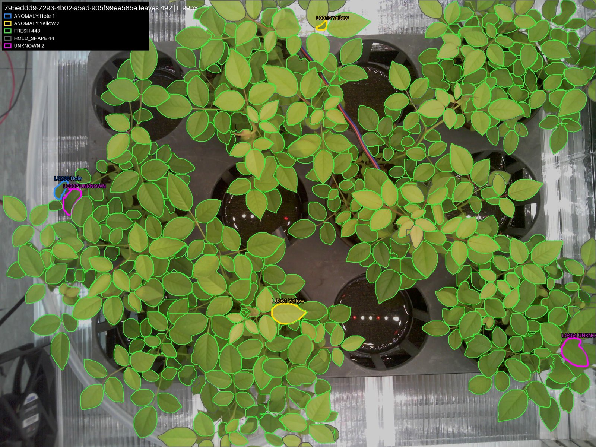
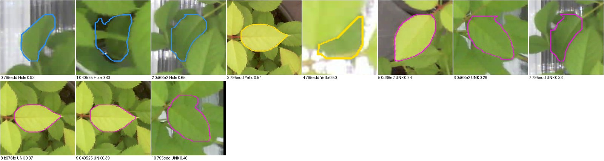

# v10 리포트: 실제 농장 사진 평가

> 그림과 비교 표를 포함한 리포트: [REPORT.html](REPORT.html) (전체 비교: [REPORTS.html](../REPORTS.html))

| 항목 | 내용 |
|---|---|
| 유형 | 평가 (모델·코드 변경 없음) |
| 작업일 | 2026-10-30 ~ 31, 추가 평가 2026-11-03 |
| 사용 모델 | v9 배포본 |
| 상태 | **평가 완료, 개선은 미착수** |

## 요약
- 농장 사진 22장(12MP), 잎 16,016개에 v9를 돌리고 표본 481개를 대조했습니다.
- 흑점병 재현율 약 46%, 이상 판정 정밀도 약 63%로 추정합니다.
- 건강 사진의 이상 판정 287개 중 실제 질병은 약 5개입니다.

**정답은 Claude 1인의 육안 판정이고, 층별 오차가 약 ±10~14%포인트입니다.** 전문가 판정이 아닙니다.

## 아키텍처 (평가 흐름)
```
농장 사진 → v9 run.py → 상태별 층화 표본(seed 42) → 판정 숨긴 시트 → 정답 대조 → 가중 추정
```

## 결과: 흑점병 사진 13장
| 판정 | 개수 | 표본 | 실제 질병 | 건강 | 잎 아님·합쳐짐 |
|---|---:|---:|---:|---:|---:|
| Black Spot | 457 | 49 | 67% | 16% | 16% |
| Hole | 337 | 43 | 42% (실제 구멍 0개) | 33% | 26% |
| Yellow | 312 | 45 | 78% | 0% | 22% |
| UNKNOWN | 282 | 28 | 61% | 25% | 14% |
| FRESH | 3,748 | 131 | 17% | 63% | 21% |


## 추가 시험
| 시험 | 결과 |
|---|---|
| Hole 기하 규칙 A (안쪽 구멍) | 기존 Hole 판정 중 5%만 남김, 건강 잎 오인 1.4%, 합성 구멍 검출 42% |
| Hole 기하 규칙 B (가장자리 홈) | 건강 잎과 구분 기준을 찾지 못함 |
| Hole 누끼 붙여넣기 | 그대로 78%, 구멍 투명 처리 67% Hole 판정 |


## 특이사항
- `gt/RESULTS.md`의 "Yellow(26%)"는 원자료와 맞지 않습니다. 표본 기준 Yellow 판정 중 흑점 잎은 18/45 = 40%입니다. 원문은 기록으로 유지합니다.
- 이상 판정 정밀도는 원자료 재계산 값 62.6%입니다.
- `inputs/`의 원본 사진 15장은 GPS 정보를 제거했습니다. 픽셀과 회전 정보는 같습니다.
- `inputs/dryleaf`는 비어 있습니다.

## 다음 단계
1. 실제 흑점 잎을 2단계 학습에 추가하고 이번 표본으로 재평가
2. 꽃·봉오리 처리 방법 결정
3. 실제 구멍 잎으로 규칙 A 확인
4. 정답을 전문가 또는 복수 판정으로 보강

## 추가 평가: ESP 카메라 교체 (2026-11-03)
교체한 ESP 카메라로 찍은 큐브 사진 6장(2560×1920)에 v9 배포본을 그대로 돌렸습니다. 모델과 설정은 바꾸지 않았고, 결과는 `esp_cam_20261103/`에 있습니다.

| 사진 묶음 | 사진 | 잎 | FRESH | HOLD_SHAPE | UNKNOWN | ANOMALY | 신뢰도 중앙값 |
|---|---:|---:|---:|---:|---:|---:|---:|
| **새 ESP 카메라** | 6 | 2,976 | 2,733 (91.8%) | 232 (7.8%) | 6 | 5 (Hole 3, Yellow 2) | 0.859 |
| 이전 `real_images_camfix` | 5 | 977 | 872 | 104 (10.6%) | 1 | 0 | 0.743 |
| 이전 `real_images_local` | 5 | 1,211 | 1,088 | 123 (10.2%) | 0 | 0 | 0.791 |

- **검출:** 사진당 잎 484~508개로 안정적이고, 눈으로 본 윤곽도 양호합니다.
- **이상·의심 11개:** 1인 육안으로 모두 질병이 아닌 잎으로 보입니다. 연한 새잎 4개, 윤곽이 겹치거나 밝은 배경에 걸린 잎 7개입니다.
- **판정 일치:** 잘 정합된 6쌍에서 짝지어진 잎 2,075쌍 중 96.1%가 같은 상태입니다. HOLD_SHAPE가 낀 쌍을 빼면 FRESH끼리 일치가 99.5%(1,921/1,930)입니다.
- **판정 흔들림:** 같은 잎으로 보이는 연한 새잎이 사진에 따라 Yellow(0.54)와 UNKNOWN(0.37~0.39)으로 달라집니다.
- **검출 재현:** 같은 배치의 사진 쌍은 약 85%(0.849, 0.852), 가지 위치가 달라 보이는 쌍은 53~67%입니다.
- **속도:** 모델 로딩을 뺀 1장당 약 2.2초입니다 (V100, 1단계 약 0.7초, 2단계 약 1.5초).





### 이번 평가의 한계
- **정답 라벨이 없습니다.** 재현율과 정밀도는 계산하지 못했고, 위 판단은 Claude 1인의 육안 확인입니다.
- **실제 이상 잎을 찾는 능력은 알 수 없습니다.** 질병 잎이 없어 보이는 장면이라, 오판이 적다는 근거만 됩니다.
- **6장은 독립 표본이 아닙니다.** 같은 트레이를 시점과 가지 위치만 달리해 찍었습니다.
- **이전 사진과 직접 비교할 수 없습니다.** 이전 사진은 대부분 v8 학습·검증·test에 쓰였고, 일부는 서로 중복이며, 촬영 시기와 식물 크기도 다릅니다.
- **촬영 시각을 알 수 없습니다.** 파일명이 UUID이고 EXIF가 없습니다.

## 차후 계획: 가지치기 후 3시간 간격 추론 확인
같은 환경에서 상단 가지치기로 잎의 실제 모습만 다르게 만들고, 3시간 간격으로 측정한 이미지의 추론 결과를 확인할 계획입니다. 일정은 아직 정해지지 않았습니다.

1. 큐브 환경과 카메라는 그대로 두고, 상단 가지를 쳐서 보이는 잎을 바꿉니다.
2. 3시간 간격으로 촬영하고, 같은 v9 배포본으로 추론합니다.
3. 잎 수, 상태별 개수, 이상 판정의 변화를 시간순으로 확인합니다.
4. 이번 결과(판정 일치 96.1%, 사진당 이상·의심 0~5개)를 잡음 기준으로 삼아 실제 변화와 구분합니다.

촬영할 때는 파일명이나 기록에 촬영 시각과 가지치기 시각을 남겨야 시간대별로 비교할 수 있습니다.

상세: [esp_cam_20261103/RESULTS.md](esp_cam_20261103/RESULTS.md), [gt/RESULTS.md](gt/RESULTS.md), [holecheck/RESULTS.md](holecheck/RESULTS.md), [paste/RESULTS.md](paste/RESULTS.md)
