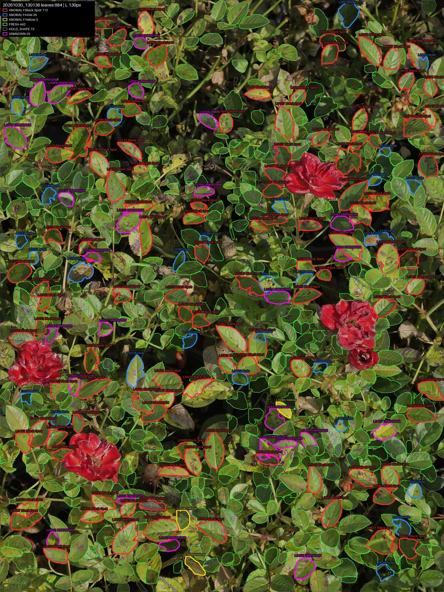
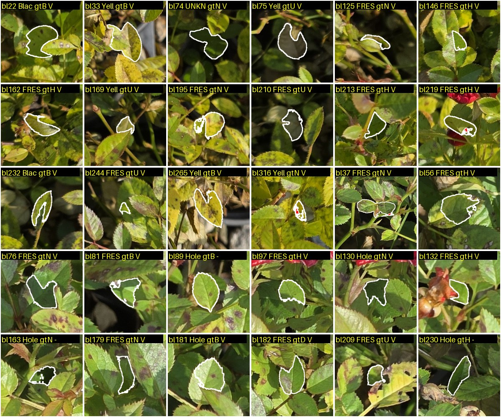

# v10 리포트: 실제 농장 사진 평가

> 그림과 비교 표를 포함한 리포트: [REPORT.html](REPORT.html) (전체 비교: [REPORTS.html](../REPORTS.html))

| 항목 | 내용 |
|---|---|
| 유형 | 평가 (모델·코드 변경 없음) |
| 작업일 | 2026-10-30 ~ 31 |
| 사용 모델 | v9 배포본 |
| 상태 | **평가 완료, 개선은 미착수** |

## 요약
- 농장 사진 22장(12MP), 잎 16,016개에 v9를 돌리고 표본 481개를 대조했습니다.
- 흑점병 재현율 약 46%, 이상 판정 정밀도 약 63%로 추정합니다.
- 건강 사진의 이상 판정 287개 중 실제 질병은 약 5개입니다.

**정답은 Claude 1인의 육안 판정이고, 층별 오차가 약 ±10~14%포인트입니다.** 전문가 판정이 아닙니다.

## 아키텍처 (평가 흐름)
```
농장 사진 → v9 run.py → 상태별 층화 표본(seed 42) → 판정 숨긴 시트 → 정답 대조 → 가중 추정
```

## 결과: 흑점병 사진 13장
| 판정 | 개수 | 표본 | 실제 질병 | 건강 | 잎 아님·합쳐짐 |
|---|---:|---:|---:|---:|---:|
| Black Spot | 457 | 49 | 67% | 16% | 16% |
| Hole | 337 | 43 | 42% (실제 구멍 0개) | 33% | 26% |
| Yellow | 312 | 45 | 78% | 0% | 22% |
| UNKNOWN | 282 | 28 | 61% | 25% | 14% |
| FRESH | 3,748 | 131 | 17% | 63% | 21% |



## 추가 시험
| 시험 | 결과 |
|---|---|
| Hole 기하 규칙 A (안쪽 구멍) | 기존 Hole 판정 중 5%만 남김, 건강 잎 오인 1.4%, 합성 구멍 검출 42% |
| Hole 기하 규칙 B (가장자리 홈) | 건강 잎과 구분 기준을 찾지 못함 |
| Hole 누끼 붙여넣기 | 그대로 78%, 구멍 투명 처리 67% Hole 판정 |



## 특이사항
- `gt/RESULTS.md`의 "Yellow(26%)"는 원자료와 맞지 않습니다. 표본 기준 Yellow 판정 중 흑점 잎은 18/45 = 40%입니다. 원문은 기록으로 유지합니다.
- 이상 판정 정밀도는 원자료 재계산 값 62.6%입니다.
- `inputs/`의 원본 사진 15장은 GPS 정보를 제거했습니다. 픽셀과 회전 정보는 같습니다.
- `inputs/dryleaf`는 비어 있습니다.

## 다음 단계
1. 실제 흑점 잎을 2단계 학습에 추가하고 이번 표본으로 재평가
2. 꽃·봉오리 처리 방법 결정
3. 실제 구멍 잎으로 규칙 A 확인
4. 정답을 전문가 또는 복수 판정으로 보강

상세: [gt/RESULTS.md](gt/RESULTS.md), [holecheck/RESULTS.md](holecheck/RESULTS.md), [paste/RESULTS.md](paste/RESULTS.md)
