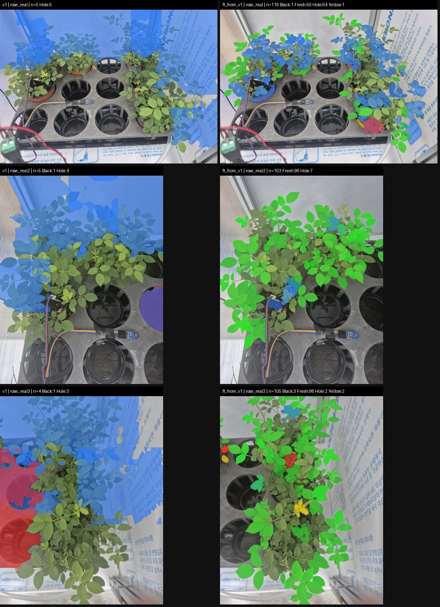

# v2 리포트: 실제 배경 합성 데이터로 재학습

| 항목 | 내용 |
|---|---|
| 유형 | 데이터 + 모델 |
| 작업일 | 2026-10-12 ~ 13 |
| 대표 모델 | `runs/ft_from_v1/weights/best.pt` |
| 상태 | 기록 보관. v4에서 이어서 학습 |

## 요약
- 실제 사진에서 잎 없는 영역만 잘라 배경 79장을 만들고, 빽빽한 장면 위주로 다시 합성했습니다.
- v1에서 이어서 학습한 모델은 v2 합성 test mask mAP50이 0.212에서 0.855로 올랐습니다.

## 아키텍처
```
실제 사진 → 잎 없는 배경 79장 추출
잎 누끼 + 실제 배경 → 합성 장면 → v1 가중치에서 이어서 학습 (ft_from_v1)
```

## 모델과 학습
| 실행 | 시작 가중치 | 설정 | 결과 |
|---|---|---|---|
| `ft_from_v1` | v1 best | epochs 50, patience 15, batch 32 | best = 30 에포크, 45 에포크 종료 |
| `coco_init` | yolo26s-seg | epochs 100, patience 20, batch 32 | best = 20 에포크, 21 에포크에서 중단 |

## 데이터
- `backgrounds/`: 실제 배경 79장
- `data/rose_seg_v2`: 장면 6,000 / 800 / 800. 빽빽한 장면 60%, 큰 잎 30%, 잎 없는 장면 10%. Fresh 50%, 나머지 18/18/14%

## 결과
| 모델 | v1 합성 test (mask mAP50 / 50-95) | v2 합성 test (mask mAP50 / 50-95) |
|---|---:|---:|
| v1 | 0.931 / 0.923 | 0.212 / 0.127 |
| ft_from_v1 | 0.920 / 0.901 | 0.855 / 0.686 |

수치 출처: `v4_reallabel/eval/summary.json`



## 특이사항
- `make_synth_v2.py`는 재실행하면 기존 데이터를 지우고 다시 만듭니다.
- `train_eval_v2.py`는 best.pt가 있는 실행을 건너뜁니다.
- `args.yaml`에는 폴더 재구성 전의 옛 경로가 남아 있습니다.
- 실제 사진 정답이 없어 실제 성능은 측정하지 못했습니다.

## 주요 파일
`scripts/` (make_backgrounds → inspect_leaves → make_synth_v2 → train_eval_v2), `runs/`, `eval/`, `debug/`
