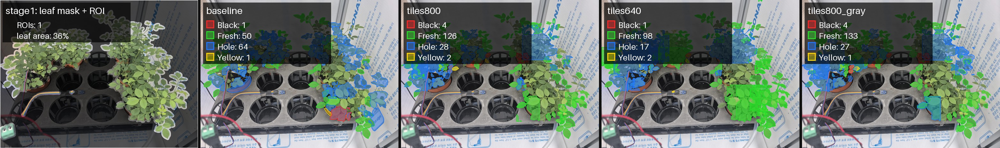

# v3 리포트: 2단계 구조 타당성 검증

> 그림과 비교 표를 포함한 리포트: [REPORT.html](REPORT.html) (전체 비교: [REPORTS.html](../REPORTS.html))

| 항목 | 내용 |
|---|---|
| 유형 | 실험 (재학습 없음) |
| 작업일 | 2026-10-13 |
| 사용 모델 | `v2/runs/ft_from_v1` |
| 상태 | 결론을 v7, v8에 반영 |

## 요약
- 색 기준(HSV) 잎 찾기는 정작 찾아야 할 갈색·마른 잎을 놓쳐 단독으로 쓸 수 없었습니다.
- 타일 예측은 멀리서 찍은 사진의 Hole 오판을 64건에서 17건으로 줄였지만, 가까이서 찍은 사진은 검출이 줄었습니다. 입력 배율을 잎 크기에 맞춰야 한다는 결론을 얻었습니다.

## 아키텍처 (검증 대상)
```
[1단계] 잎 영역 찾기 → [2단계] 영역을 잘라 이상 상태 분리
```

## 결과
| 사진 | 방식 | 검출 | Fresh | Hole |
|---|---|---:|---:|---:|
| 1 (멀리서) | 640 축소 | 116 | 50 | 64 |
| 1 | 640px 타일 | 118 | 98 | 17 |
| 2 (가까이) | 640 축소 | 103 | 96 | 7 |
| 2 | 640px 타일 | 48 | 44 | 3 |



## 결론
1. 색 기준은 단독 1단계로 쓰지 않습니다.
2. 잎 크기를 추정해 640 입력에서 약 30~90px이 되도록 조정합니다.
3. 배경 처리는 학습 데이터에도 함께 적용할 때만 의미가 있습니다.

상세: [README.md](README.md)
