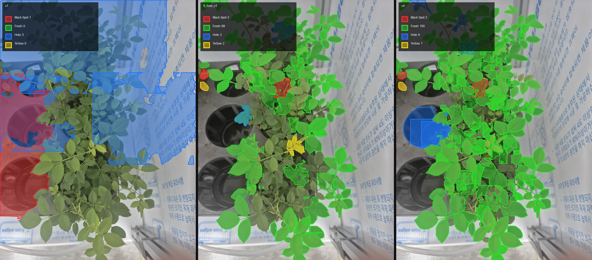

# v4 리포트: 실제 잎 누끼를 넣은 재학습

> 그림과 비교 표를 포함한 리포트: [REPORT.html](REPORT.html) (전체 비교: [REPORTS.html](../REPORTS.html))

| 항목 | 내용 |
|---|---|
| 유형 | 데이터 + 모델 |
| 작업일 | 2026-10-13 |
| 대표 모델 | `runs/ft_from_v2ft/weights/best.pt` |
| 상태 | v6, v7의 기반. v8 시작 가중치 |

## 요약
- 실제 사진 2장에서 잎 누끼 27장을 골라 합성 데이터의 Fresh 잎 30%에 대체해 넣었습니다.
- 합성 test는 v2와 비슷했고(mask mAP50 0.846), 실제 사진은 눈으로만 비교했습니다.

## 아키텍처
```
ft_from_v1 초안 마스크 → 품질 지표로 후보 선정 → Claude 검토 → 누끼·라벨 초안
v2 합성 + 실제 잎 누끼 27장 → ft_from_v1에서 이어서 학습
```

## 모델과 학습
`ft_from_v1`에서 시작, epochs 25, patience 8, batch 32, imgsz 640. best = 19 에포크

## 데이터
| 사진 | 초안 마스크 | 누끼 후보 | 채택 |
|---|---:|---:|---:|
| rose_real (학습) | 308 | 56 | 17 |
| rose_real2 (학습) | 163 | 39 | 10 |
| rose_real3 (평가) | 163 | 29 | - |

후보 95개 중 68개 제외 (합쳐짐 37, 잘림·가려짐 24, 배경 섞임 4, 계단 경계 1, 식물 전체 2)

## 결과
| 모델 | v1 합성 test | v2 합성 test |
|---|---:|---:|
| ft_from_v1 | 0.920 / 0.901 | 0.855 / 0.686 |
| v4 | 0.923 / 0.904 | 0.846 / 0.683 |



## 특이사항
- `labels_draft`는 초안이라 정답으로 쓸 수 없습니다.
- 누끼는 모두 Fresh이며, 병든 잎은 여전히 공개 데이터셋에 의존합니다.
- 평가용으로 둔 `rose_real3`은 나중에 `cube_07`과 같은 사진으로 확인됐습니다 (v8 참고).

상세: [README.md](README.md)
