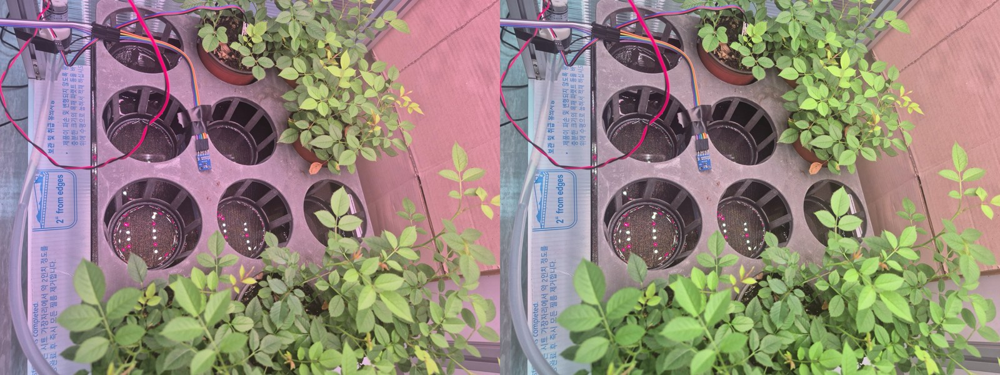

# v5 리포트: 큐브 사진 평가와 화이트밸런스 시험

| 항목 | 내용 |
|---|---|
| 유형 | 평가 (재학습 없음) |
| 작업일 | 2026-10-13 |
| 사용 모델 | v2 `ft_from_v1`, v4 |
| 상태 | 결론을 v6에 반영 |

## 요약
- 스마트폰 큐브 사진 18장에 모델을 돌렸습니다. 분홍 LED 아래에서 연두색 새순이 Yellow로, 빈 트레이 칸이 Hole로 판정되는 문제를 확인했습니다.
- gray world 화이트밸런스만으로 v4의 Yellow 판정이 408건에서 86건으로 줄었습니다.

## 아키텍처
```
사진 → (선택) gray world 화이트밸런스 → v4 예측 → 클래스별 판정 수 비교
```

## 결과 (큐브 18장 합계)
| 처리 | Fresh | Hole | Black Spot | Yellow |
|---|---:|---:|---:|---:|
| v4 원본 | 2,307 | 211 | 153 | 408 |
| v4 + 화이트밸런스 | 2,957 | 181 | 72 | 86 |



## 한계
실제 사진 정답이 없어 판정 수 변화와 눈으로 본 비교만 있습니다.

## 주요 파일
`scripts/cube_eval.py`, `scripts/wb_test.py`, `eval/v4`, `eval/ft_from_v1`, `eval/wb_test`
