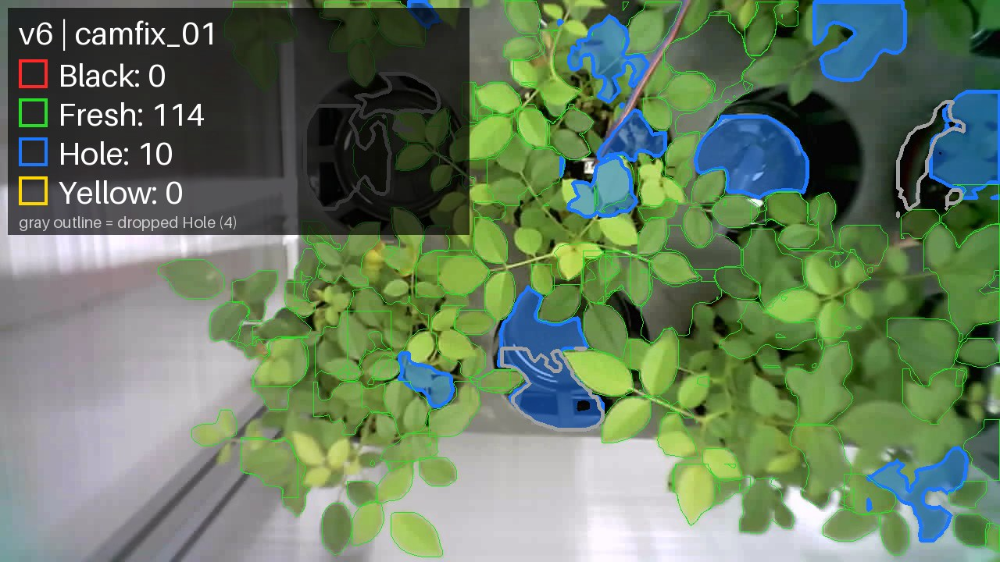

# v6 리포트: 색 보정과 Hole 필터 추론 파이프라인

| 항목 | 내용 |
|---|---|
| 유형 | 코드 (재학습 없음) |
| 작업일 | 2026-10-13 |
| 사용 모델 | v4 |
| 상태 | v7 1단계에서 사용, v8에서 필터 제거 |

## 요약
- v4 앞뒤에 화이트밸런스와 Hole 필터를 더했습니다. 큐브 18장 Hole 판정이 211건에서 129건으로 줄었습니다.
- 남은 Hole은 대부분 건강한 잎 무리라 필터로 해결되지 않았습니다.

## 아키텍처
```
사진 → gray world 화이트밸런스 → v4 예측 → Hole 필터(잎 색 비율 0.5 미만 제거) → 결과
```

## 결과 (Hole 판정 수)
| 사진 세트 | v4 원본 | + 화이트밸런스 | + 필터 0.5 |
|---|---:|---:|---:|
| 큐브 18장 | 211 | 181 | 129 |
| 고정 카메라 1장 | 14 | 14 | 10 |
| 기존 실사 3장 | 56 | 57 | 50 |



## 특이사항
- 필터는 빈 칸, 트레이, 전선 판정을 제거합니다.
- 잎 사이 틈이 보이는 잎 무리와 빈 화분의 반사는 남습니다.

상세: [README.md](README.md)
