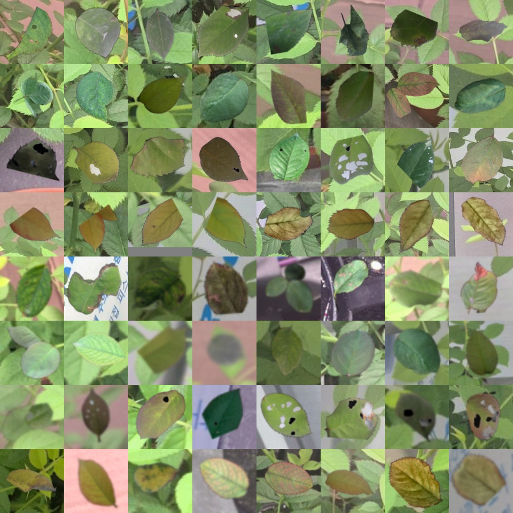

# v7 리포트: 잎 탐색과 잎별 분류의 2단계 구조

> 그림과 비교 표를 포함한 리포트: [REPORT.html](REPORT.html) (전체 비교: [REPORTS.html](../REPORTS.html))

| 항목 | 내용 |
|---|---|
| 유형 | 구조 + 모델 |
| 작업일 | 2026-10-14 |
| 대표 모델 | 1단계 v4 + v6 필터, 2단계 `cls/runs_bbox_real_aug/effnetv2s/best.pt` |
| 상태 | v8에서 1, 2단계 모두 재학습 |

## 요약
- 찾기와 판정을 나눠 잎 ID별로 EfficientNetV2-S가 상태를 분류하게 했습니다.
- 실제 잎 오판의 주원인은 모델이 아니라 입력 형태였습니다. 누끼를 주변 포함 크롭으로 바꾸자 판정 대상 462개의 이상 판정이 55.2%에서 16.2%로 줄었습니다.
- 실제 건강 잎만 넣으면 지름길을 학습해서, 같은 잎에 합성 이상을 함께 넣었습니다.

## 아키텍처
```
사진 → v6 (색 보정 + v4 + Hole 필터) → 잎 색·배경 필터 → 중복 제거 → 잎 ID
     → 판정 보류(볼록도 0.8 미만, 가장자리)
     → 긴 변 ×1.25 크롭 → 224 → EfficientNetV2-S → 4클래스
```

## 모델 비교 (누끼 입력)
| 모델 | test acc / F1 | 실제 잎 이상 판정 (603개) | ms/장 |
|---|---:|---:|---:|
| EfficientNetV2-S | 0.961 / 0.940 | 58.7% | 1.8 |
| YOLO11s-cls | 0.942 / 0.873 | 40.6% | 1.0 |
| DINOv2 ViT-S/14 | 0.920 / 0.854 | 33.0% | 36.5 |

ConvNeXt-Tiny를 제외한 이유: [cls/MODEL_SELECTION.md](cls/MODEL_SELECTION.md)

## 입력과 학습 데이터 개선 (EfficientNetV2-S)
| 구성 | 고정 카메라 오판 | 학습에 안 쓴 사진 오판 | 실제 잎 위 합성 이상 검출 |
|---|---:|---:|---:|
| 크롭 입력 | 16.2% | 4.0% | 0.647 |
| + 실제 건강 잎 | 0.4% | 0.0% | 0.433 |
| + 같은 잎에 합성 이상 | 0.9% | 0.5% | 0.980 |



## 트러블슈팅과 특이사항
- 마스크 겹침 계산을 박스 범위로 줄여 사진당 최대 113초를 9초로 단축했습니다.
- 빈 화분, 반사, 회색 트레이를 거르는 배경 필터를 추가했습니다. v8에서는 그늘진 잎을 버려 제거했습니다.
- "학습에 안 쓴 사진" 수치에는 누수가 있습니다. `rose_real`이 `cube_22`와 같은 사진입니다 (v8에서 발견).
- `cls/runs_bbox_aborted_022537`은 중단된 실행입니다.

## 한계
고정 카메라 정답 462개에 실제 이상 잎이 0개라 실제 이상 검출률은 측정하지 못했습니다.

상세: [README.md](README.md), [cls/MODEL_SELECTION.md](cls/MODEL_SELECTION.md)
