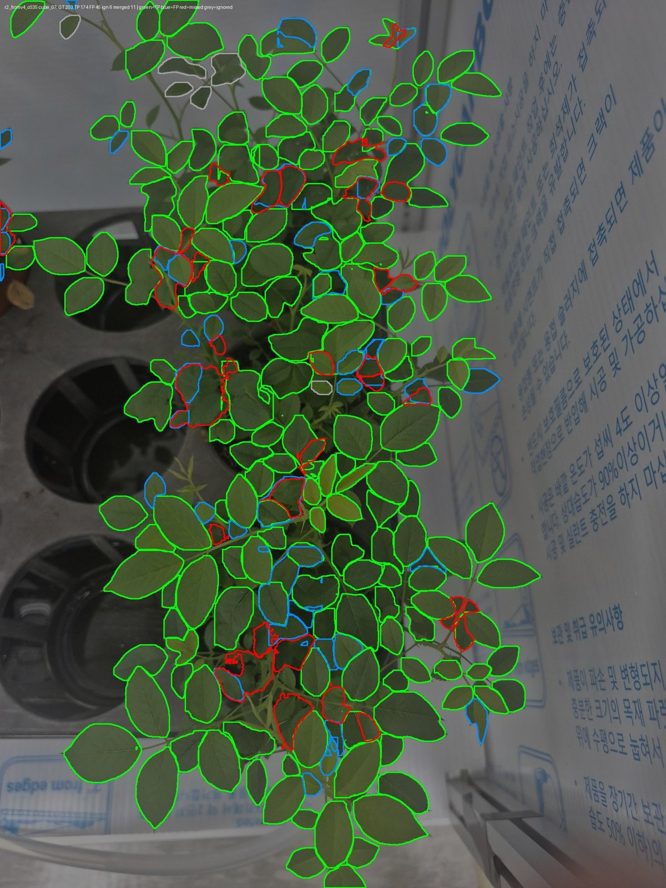
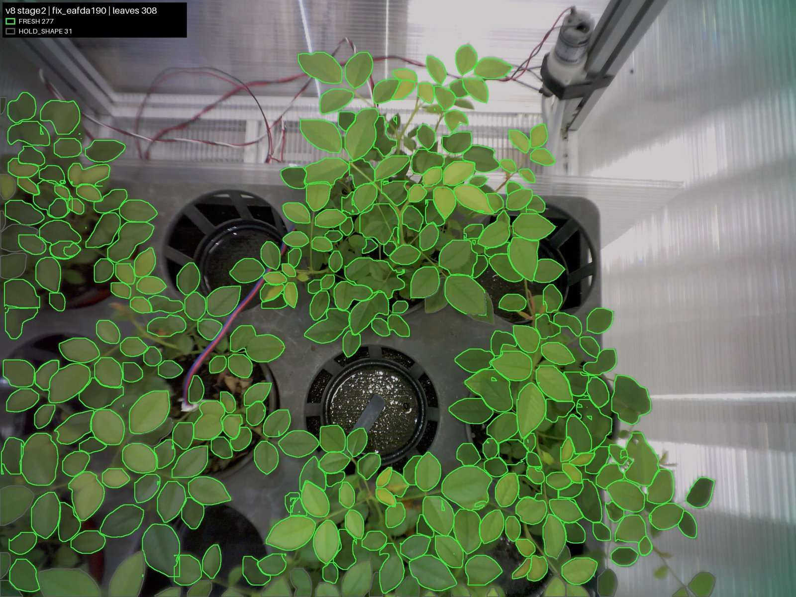

# v8 리포트: 실제 사진 라벨로 1, 2단계 재학습

> 그림과 비교 표를 포함한 리포트: [REPORT.html](REPORT.html) (전체 비교: [REPORTS.html](../REPORTS.html))

| 항목 | 내용 |
|---|---|
| 유형 | 데이터 + 모델 + 코드 |
| 작업일 | 2026-10-14 ~ 20 |
| 대표 모델 | `runs/r2_fromv4/weights/best.pt`, `cls/runs/effnetv2s/best.pt` |
| 상태 | **현재 모델 원본** (배포 코드는 v9) |

## 요약
| 지표 (test 4장, 정답 잎 880) | 이전 → v8 |
|---|---:|
| 1단계 F1 | 0.622 → 0.782 |
| 2단계까지 간 정답 잎 | 50.2% → 73.1% |
| 건강 잎 865개 이상 오판 | 24 → 0 |
| 합쳐진 예측 (파이프라인) | 96 → 31 |
| 합성 이상 검출 | 99.8% (학습과 같은 방식이라 낙관적) |

## 아키텍처
```
입력 → 잎 크기 L 추정(1280, 박스 긴 변 중앙값)
     → 1단계 YOLO26s-seg 1클래스 (L×8 타일, 25% 겹침, 640, 신뢰도 0.35) → 중복 병합
     → 판정 보류 (볼록도 0.8 미만, 사진 가장자리)
     → 화이트밸런스 → 긴 변 ×1.25 크롭 → 224 → EfficientNetV2-S
     → FRESH / ANOMALY / UNKNOWN / HOLD_SHAPE
```

## 모델과 학습
| 단계 | 설정 | 비고 |
|---|---|---|
| 1단계 | v4에서 시작, 100 에포크, batch 16, imgsz 640 | r2 라벨 사용 |
| 2단계 | EfficientNetV2-S, 20 에포크, AdamW 3e-4, batch 64, label smoothing 0.1 | val macro-F1 0.940 |

## 데이터
- 고유 장면 27장: train 20, val 3, test 4 (`scenes.json`)
- 라벨: SAM2.1 초안 → 격자 보충 → 타일 검토 → 모델 보완 (놓친 잎 213개 추가, 합쳐진 마스크 152개 교체)
- test는 Claude 타일 검토, train과 val은 대부분 자동 라벨입니다.
- `inputs_20261019`: 이후 추가한 12MP 사진 9장 (학습 미사용)

## 결과
| 1단계 모델 | 재현율 | 정밀도 | F1 |
|---|---:|---:|---:|
| 기존 v4 | 0.615 | 0.629 | 0.622 |
| r1_fromv4 | 0.801 | 0.761 | 0.780 |
| r1_coco11s | 0.793 | 0.757 | 0.775 |
| **r2_fromv4, 신뢰도 0.35** | **0.797** | **0.768** | **0.782** |

v8 안에서의 차이는 4장 기준 오차 범위 안입니다.





## 트러블슈팅과 특이사항
- v4용 배경 필터가 그늘진 잎을 버려 재현율이 0.80에서 0.61로 떨어져 제거했습니다.
- 사진 중복 검사로 `rose_real`, `rose_real2`, `rose_real3`이 `cube_22`, `cube_19`, `cube_07`과 같음을 발견했습니다.
- test 보류 98개 중 61개는 정상적인 잎 한 장이라 판정 보류 규칙에 개선이 필요합니다.

## 한계
- 이 버전에서는 실제 이상 잎 검출률을 측정하지 못했습니다 (v10에서 추정).
- test가 4장이고 학습 사진과 같은 챔버, 같은 시기입니다.

상세: [README.md](README.md), [deploy/README.md](deploy/README.md). 리포트 원본 HTML은 이 저장소에 없습니다.
